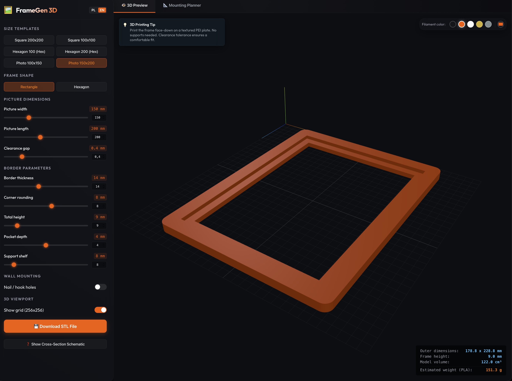

# 🖼️ FrameGen 3D — HueForge & Photo Frame Generator

An interactive web app to design, preview in 3D, and export printable STL frames for [HueForge](https://www.hueforge.com/) prints and photos.

<!-- 🔗 Uncomment when deployed:
**[▶ Live Demo](https://ventus34.github.io/hueforge-frame-generator/)**
-->



---

## 🌟 Features

- **Interactive 3D Preview** — Real-time Three.js rendering with PLA color presets, custom hex picker, OrbitControls, and a virtual print-bed grid.
- **Parametric Keyhole Hangers** — Watertight vertical keyhole mounting slot generated from technical wood-milling specs.
- **Proportional Auto-Scaling** — Keyhole dimensions shrink automatically when the border is too narrow, keeping walls intact.
- **Rounded Outer Corners** — Adjustable corner radii with smooth rectangular-inner → rounded-outer transitions.
- **Hexagonal Frames** — Full honeycomb support for tiling prints on walls.
- **2D Mounting Planner** — Drag-and-drop canvas for arranging Command strips (S / M / L) on the frame's back.
- **Manifold STL Compiler** — Zero-dependency binary STL writer producing watertight meshes in milliseconds.
- **Live Stats** — Bounding dimensions, volume (cm³), and estimated filament weight updated in real time.

---

## 🛠️ Tech Stack

| Layer | Technology |
|-------|-----------|
| UI | React 19, TypeScript |
| Build | Vite 8 |
| Styling | Vanilla CSS — custom properties, glassmorphism, CSS Grid |
| 3D | Three.js (vanilla WebGL wrapper) |
| Geometry & Export | Custom unindexed B-Rep buffer geometry compiler + binary STL writer |

---

## 🚀 Getting Started

### Prerequisites

- **Node.js** ≥ 18 (LTS recommended)
- **npm** ≥ 9

### 1. Clone & install

```bash
git clone https://github.com/ventus34/hueforge-frame-generator.git
cd hueforge-frame-generator
npm install
```

### 2. Run dev server

```bash
npm run dev
```

Open [http://localhost:5173](http://localhost:5173) in your browser.

### 3. Build for production

```bash
npm run build
```

The optimized bundle lands in `dist/`. A copy is also kept in `docs/` for GitHub Pages hosting.

---

## 📐 Parameters Guide

| Parameter | Description |
|-----------|-------------|
| **Picture size** | Dimensions of your HueForge print or photo |
| **Clearance** | Gap around the print for comfortable fit (default 0.2 mm) |
| **Border thickness** | Width of the outer frame border |
| **Frame height** | Total Z-height of the frame |
| **Pocket depth** | Recess depth in the back where the print sits |
| **Support shelf** | Inner lip that holds the print and prevents it from falling forward |
| **Corner radius** | Outer corner rounding (rectangular frames only) |

---

## 🇵🇱 O Projekcie

Interaktywna aplikacja webowa służąca do projektowania i generowania gotowych plików STL z ramkami do wydruków HueForge oraz tradycyjnych zdjęć.

**Możliwości:**
- Podgląd 3D modelu w różnych kolorach filamentu (wbudowany próbnik + dowolny kolor HEX) na wirtualnym stole roboczym
- Planowanie rozmieszczenia rzepów montażowych (Command strips) w interaktywnym planerze 2D
- Dodawanie wycięć pod gwoździe (Keyhole Slot) z automatycznym dopasowaniem do szerokości ścianki
- Generowanie i pobieranie pliku STL gotowego do druku 3D

---

## 📄 License

MIT © [ventus34](https://github.com/ventus34)

---

<sub>Built with assistance from Antigravity AI (Google DeepMind).</sub>
